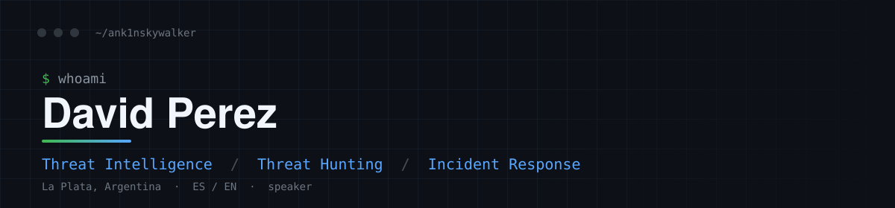

Analista en ciberseguridad. Mis tres áreas fuertes son **Threat Intelligence**, **Threat Hunting** e **Incident Response**.

Trabajo con organizaciones del sector público y financiero de Uruguay, Argentina y Chile, y doy charlas sobre cómo pasar de la inteligencia de amenazas a la acción: qué cazar, cómo atribuir y cómo escribir el informe para que alguien lo use.

## Qué encontrás acá

| Repositorio | Contenido |
|---|---|
| 🎤 **[talks](https://github.com/Ank1nskywalker/talks)** | Slides y material de mis charlas, organizado por año |
| 🧰 **[Templates](https://github.com/Ank1nskywalker/Templates)** | Plantillas reutilizables, como el informe de threat hunting (ES / EN) |

## Charlas recientes

| Cuándo | Evento | Charla |
|---|---|---|
| Nov 2026 | DEATHCon · Online + Córdoba | **Writing the Incident Story** · workshop |
| Oct 2026 | Hacking Day · Paraná | **Cazando lo que no sabés que no sabés** |
| Sep 2026 | CYBER.AR · Buenos Aires | **CTI proactiva para la ciberdefensa** |
| May 2026 | Ekoparty Miami | **Threat Intelligence 101** |

→ [Ver todas las charlas](https://github.com/Ank1nskywalker/talks)

## Especialidades

**Threat Intelligence** · **Threat Hunting** · **Incident Response**

`MITRE ATT&CK` · `Dark Web` · `Detección de amenazas` · `Atribución`

## Contacto

